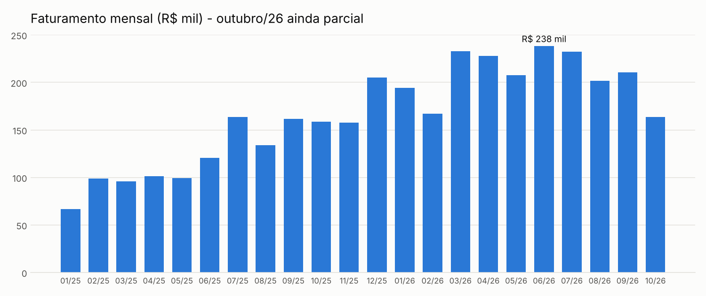
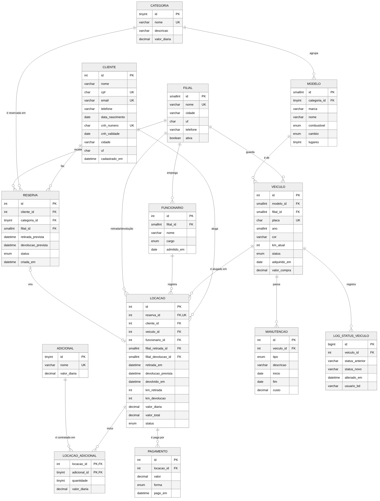
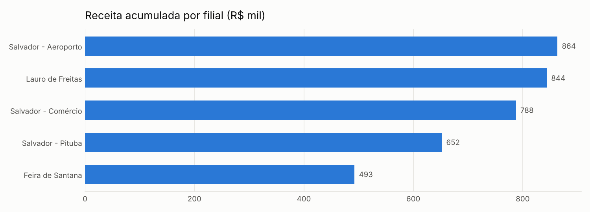

# WelCar Locações · Banco de dados de uma locadora de veículos

Projeto de banco de dados relacional em **MySQL 8** para uma locadora de carros com 5 filiais na Bahia. Ele vai da modelagem até a análise: diagrama ER, tabelas com restrições de integridade, regras de negócio dentro do banco (procedures, funções e triggers), views, controle de acesso por perfil, consultas analíticas com CTE e window functions, e scripts Python para gerar dados, testar e montar relatórios.

O banco já vem com **quase 2 anos de operação simulada** (jan/2025 a out/2026): 52 carros, 420 clientes, 3.398 locações, 4.162 pagamentos e 332 manutenções. Os dados são fictícios, mas coerentes: um carro nunca está em duas locações ao mesmo tempo, a quilometragem só sobe, e cada valor cobrado bate com a regra de cálculo do banco.



## Tecnologias

- **MySQL 8.4**: DDL, constraints (PK, FK, UNIQUE, CHECK), índices, views, stored procedures, funções, triggers, transações e roles
- **Python 3**: gerador de dados, testes automatizados (`unittest`), relatório com `matplotlib` e dicionário de dados gerado a partir do `information_schema`
- **Docker Compose**: sobe o banco pronto com um comando
- **Mermaid**: diagrama entidade-relacionamento versionado como texto

## O problema que o banco resolve

Uma locadora precisa saber, a qualquer momento, **quais carros estão livres e onde**, **quem está com qual carro**, **quanto cobrar na devolução** e **quanto cada carro rende**. As regras abaixo ficam no próprio banco, então valem para qualquer sistema que se conecte a ele:

| Regra | Onde é garantida |
|---|---|
| Cliente precisa ter 21 anos ou mais e CNH válida até a data de devolução | `sp_abrir_locacao` |
| Só se aluga carro com status `disponivel`; a linha é travada (`FOR UPDATE`) para dois atendentes não alugarem o mesmo carro | `sp_abrir_locacao` + `trg_locacao_bi` |
| O atendente precisa ser da filial onde o carro está | `sp_abrir_locacao` |
| Se algo falha no meio, nada é gravado (transação com `ROLLBACK`) | `sp_abrir_locacao`, `sp_encerrar_locacao` |
| Diárias de 24h com 1h de tolerância; atraso cobra a diária do carro com 20% a mais; devolver em outra filial custa R$ 150 | `fn_dias_cobrados`, `fn_valor_locacao` |
| A quilometragem nunca diminui | `trg_veiculo_bu` + `CHECK` |
| Abrir manutenção tira o carro da frota; fechar devolve | `trg_manutencao_ai`, `trg_manutencao_au` |
| Não se recebe pagamento acima do valor devido | `trg_pagamento_bi` |
| Toda mudança de status do carro fica registrada (auditoria) | `trg_veiculo_au` → `log_status_veiculo` |
| A diária e o preço dos adicionais ficam "congelados" no contrato | colunas `valor_diaria` em `locacao` e `locacao_adicional` |

## Modelo de dados

13 tabelas normalizadas. A reserva é feita por **categoria** (como nas locadoras reais) e vira uma **locação** quando o cliente retira um carro específico. Adicionais e locações têm relação N:N.



O fonte do diagrama está em [`docs/diagrama-er.mmd`](docs/diagrama-er.mmd), e a descrição de cada coluna em [`docs/dicionario-de-dados.md`](docs/dicionario-de-dados.md).

## Estrutura

```
├── sql/                          # rodam em ordem e criam o banco do zero
│   ├── 01_schema.sql             # tabelas, chaves, CHECKs e índices
│   ├── 02_dados.sql              # carga gerada pelo gerador/
│   ├── 03_funcoes_procedures.sql # regras de negócio e relatório
│   ├── 04_views.sql              # visões para operação e BI
│   ├── 05_triggers.sql           # integridade e auditoria
│   └── 06_seguranca.sql          # perfis atendente / analista / gerente
├── consultas/
│   └── consultas_analiticas.sql  # 17 perguntas de negócio respondidas em SQL
├── gerador/gerar_dados.py        # simulação da operação (gera o 02_dados.sql)
├── testes/test_regras.py         # 11 testes das procedures e triggers
├── python/
│   ├── relatorio.py              # exporta CSVs e gera os gráficos
│   └── dicionario_dados.py       # gera o dicionário de dados
├── docs/                         # diagrama, dicionário e gráficos
└── docker-compose.yml
```

## Como rodar

### Com Docker (recomendado)

```bash
docker compose up -d
```

Na primeira vez o MySQL executa todos os scripts de `sql/` e o banco fica pronto em cerca de 30 segundos. Conecte em `localhost:3306`, usuário `root`, senha `welcar123` (pelo MySQL Workbench, DBeaver ou terminal):

```bash
docker exec -it welcar-mysql mysql -uroot -pwelcar123 welcar_locacoes
```

Para apagar tudo e recriar do zero: `docker compose down -v` e depois `docker compose up -d`.

### Sem Docker

Num MySQL 8 já instalado, execute os arquivos de `sql/` **na ordem** (01 a 06). No MySQL Workbench: *File → Open SQL Script* e *Execute* em cada um. Pelo terminal:

```bash
for f in sql/0*.sql; do mysql -uroot -p < "$f"; done
```

### Parte em Python

```bash
python -m venv .venv
source .venv/bin/activate        # no Windows: .venv\Scripts\activate
pip install -r requirements.txt

python -m unittest discover -s testes -v   # testes das regras do banco
python python/relatorio.py                 # CSVs em python/saida/ e gráficos em docs/
python python/dicionario_dados.py          # atualiza docs/dicionario-de-dados.md
python gerador/gerar_dados.py              # gera de novo o sql/02_dados.sql
```

Se o seu MySQL usa outra senha ou porta, defina as variáveis `DB_HOST`, `DB_PORT`, `DB_USER` e `DB_PASSWORD`.

## Usando as procedures

```sql
-- Cliente 15 retira o carro 3 com o atendente 2, por 4 dias, sem reserva
CALL sp_abrir_locacao(15, 3, 2, 4, NULL, @locacao);
SELECT @locacao;

-- Inclui uma cadeirinha infantil
CALL sp_adicionar_adicional(@locacao, 2, 1);

-- Devolução com 48.300 km na filial 1: calcula e devolve o valor final
CALL sp_encerrar_locacao(@locacao, 48300, 1, @valor);
SELECT @valor;

-- Faturamento por filial no 1º trimestre de 2026
CALL sp_faturamento_periodo('2026-01-01', '2026-03-31');
```

Quando uma regra é violada, o banco responde com uma mensagem clara, por exemplo `CNH vencida ou vence antes da devolução.` ou `Veículo não está disponível.`

> Os IDs acima são só ilustração: a procedure recusa o carro se ele estiver alugado e o atendente se ele for de outra filial. Para achar uma combinação válida, consulte `vw_frota` (carros com status `disponivel`) e a tabela `funcionario`.

## Consultas analíticas

O arquivo [`consultas/consultas_analiticas.sql`](consultas/consultas_analiticas.sql) responde 17 perguntas, das mais simples às mais avançadas:

| # | Pergunta | Técnica |
|---|---|---|
| 1 | Carros livres no aeroporto agora | JOIN em view |
| 2 | Receita e ticket médio por categoria | GROUP BY |
| 3 | Clientes mais fiéis | HAVING |
| 4 | Clientes que nunca alugaram | NOT EXISTS |
| 5 | CNHs vencidas ou vencendo | funções de data |
| 6 | Inadimplência por cliente | view de saldo |
| 7 | Crescimento mês a mês e ano a ano, acumulado no ano | CTE + `LAG` + `SUM() OVER` |
| 8 | Categoria campeã de cada filial | `ROW_NUMBER() OVER (PARTITION BY)` |
| 9 | Curva ABC de clientes | soma acumulada com window function |
| 10 | Taxa de ocupação da frota por mês | CTE recursiva + junção por intervalo de datas |
| 11 | Carros com melhor e pior retorno | UNION ALL de rankings |
| 12 | Tempo parado entre locações | `LAG` por veículo |
| 13 | Pontualidade das devoluções por filial | agregação condicional |
| 14 | Conversão de reservas | agregação condicional |
| 15 | Adicionais mais vendidos | tabela N:N |
| 16 | Participação das formas de pagamento | pivot com `CASE` |
| 17 | Carros com revisão vencida | subconsulta correlacionada |

Exemplo da consulta 7 (crescimento de receita):

| mês | receita | vs. mês anterior | vs. mesmo mês de 2025 |
|---|---:|---:|---:|
| 2026-07 | 232.201,80 | -2,6% | +42,1% |
| 2026-08 | 201.635,36 | -13,2% | +50,3% |
| 2026-09 | 210.718,82 | +4,5% | +30,2% |



## Segurança

O script `06_seguranca.sql` cria três perfis (roles) com o mínimo de permissão necessário:

- **welcar_atendente**: consulta clientes e frota e opera locações **somente pelas procedures**. Não consegue alterar um valor de locação direto na tabela.
- **welcar_analista**: lê apenas as views de faturamento e frota. Não vê CPF nem CNH dos clientes.
- **welcar_gerente**: tudo dos dois perfis anteriores, mais o cadastro da frota e das manutenções.

As senhas dos usuários de exemplo são fictícias e devem ser trocadas fora de um ambiente de estudo.

## Testes

`testes/test_regras.py` testa o banco de verdade: o fluxo completo de locação, o cálculo com adicionais e taxa de outra filial, a recusa de CNH vencida, de carro já alugado e de atendente de outra filial, o `ROLLBACK` quando algo falha no meio, as triggers de quilometragem, manutenção e pagamento, e confere que **todas as 3.398 locações do histórico** têm o valor igual ao calculado por `fn_valor_locacao`.

```
Ran 11 tests in 0.39s
OK
```

## Observações

- A simulação vai até **20/10/2026**. As views que usam a data atual (como `vw_locacoes_abertas`) mostram atrasos maiores conforme o tempo passa. Para gerar dados até outra data: `python gerador/gerar_dados.py 2027-03-15`.
- Todos os nomes, CPFs, placas e telefones são gerados aleatoriamente. Os CPFs têm dígitos verificadores válidos, mas não pertencem a ninguém.

## Autor

**Elson Rocha Evangelista**, Tecnólogo em Análise e Desenvolvimento de Sistemas (Estácio) e pós-graduando em Engenharia de Dados e IA.
